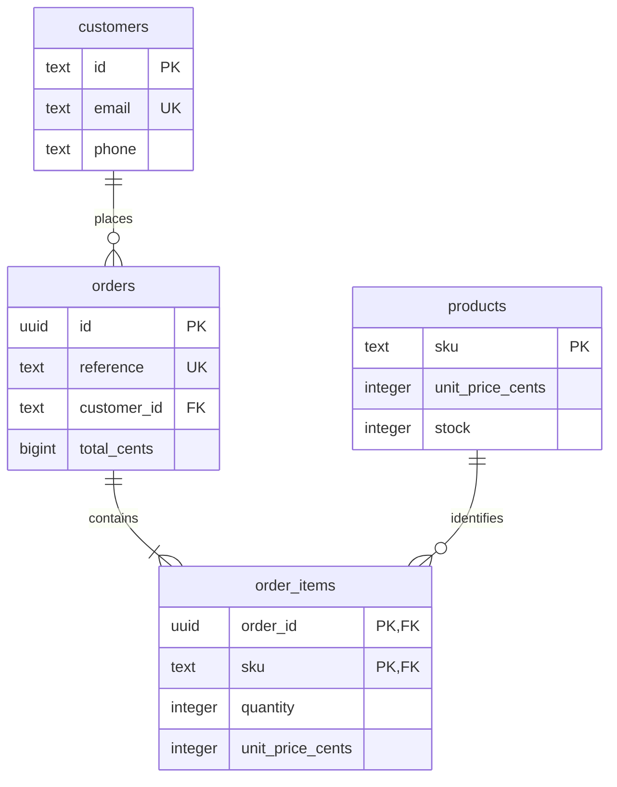

# API contract and data model

## A deliberate extension of the Postman domain

The first case accepted a single product and kept orders in memory. This contract
adds a client reference, multiple items and committed PostgreSQL records. It is
versioned teaching material, not a drop-in replacement for the original collection.

Fresh data: Alice and Bob; ten notebooks at 1,299 cents each; twenty pens at 299
cents each. Alice's optional phone is NULL. All customers and tokens are synthetic.



The diagram shows intended business cardinality. Foreign keys prevent orphaned
items, but they cannot by themselves require every order to have at least one item.
That invariant and total reconciliation also require application/integration checks.

## HTTP behavior

All routes except GET /health require `Authorization: Bearer demo-alice-token`
or `Bearer demo-bob-token`. Missing/unknown credentials return 401 UNAUTHENTICATED.
Responses and errors are JSON; an error is `{"error":{"code":"CODE"}}`.

| Route | Contract |
| --- | --- |
| `GET /health` | 200 ready after a database connection succeeds |
| `GET /products/{sku}` | 200 with sku, unitPriceCents and stock; unknown product returns 404 |
| `POST /orders` | Create a confirmed order and update stock in one transaction |
| `GET /orders/{uuid}` | Owner gets 200; another user gets 403; missing order gets 404 |
| `GET /orders` | Return only the authenticated user's orders, ordered by reference |

Creation body:

```json
{
  "reference":"order-001",
  "items":[
    {"sku":"QA-NOTEBOOK","quantity":2},
    {"sku":"QA-PEN","quantity":3}
  ]
}
```

A reference contains 1–64 ASCII letters, digits, underscores or hyphens and is
unique across all customers. There must be 1–5 distinct product entries. Quantities
are JSON integers from one to one million; booleans, strings and fractions are
rejected. Catalog price is authoritative. Extra client fields are ignored.

Success returns 201, a relative Location header, and exactly the order ID,
reference, owner, confirmed status, items and totalCents. Items are sorted by SKU.
The example totals **3,495 cents** and leaves notebook stock eight and pen stock
seventeen. The application commits before sending success.

## Rejections and transaction boundaries

| Condition | HTTP | Code |
| --- | --- | --- |
| Unsupported media type | 415 | UNSUPPORTED_MEDIA_TYPE |
| Malformed JSON or non-object body | 400 | INVALID_BODY |
| Invalid reference | 400 | INVALID_REFERENCE |
| Missing/invalid item list | 400 | INVALID_ITEMS |
| Repeated SKU | 400 | DUPLICATE_PRODUCT |
| Invalid quantity | 400 | INVALID_QUANTITY |
| Unknown product | 404 | PRODUCT_NOT_FOUND |
| Insufficient stock | 409 | INSUFFICIENT_STOCK |
| Reused reference | 409 | DUPLICATE_REFERENCE |
| Existing order owned by someone else | 403 | FORBIDDEN |
| Unknown valid order UUID | 404 | ORDER_NOT_FOUND |
| Unknown route or malformed route UUID | 404 | ROUTE_NOT_FOUND |

Creation validates input, inserts the order header, then processes items in sorted
SKU order. Each product is selected FOR UPDATE, stock is checked/reduced, and the
item is inserted. Finally the total is updated. All these writes share one
transaction. A propagated exception rolls back the header, item rows and stock.

Tests deliberately make the second item fail after first-item writes. A rejection
before any write would not demonstrate this late rollback behavior.

The connection uses PostgreSQL's default READ COMMITTED isolation. Row locks are
held until transaction completion. Stable SKU order reduces deadlock risk but
concurrent behavior is not part of the executed coverage. Duplicate reference
returns a conflict, not the prior result: uniqueness is not idempotent replay.

The risk map lists executed coverage. Other documented endpoints and validation
branches are not automatically considered tested because they exist here.
